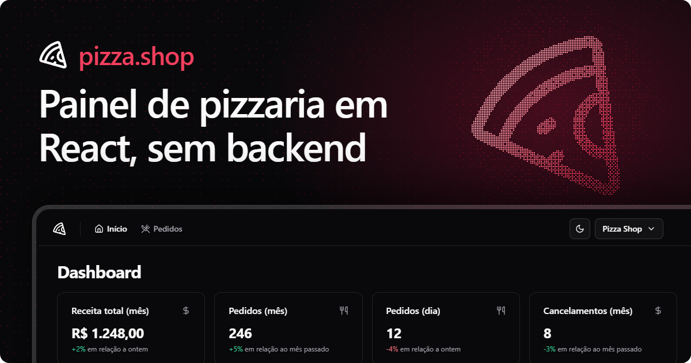

  

  
  
  
  
  

# pizza.shop

Painel de gestão de pizzaria feito no curso de React da [Rocketseat](https://github.com/rocketseat-education/pizzashop-web). O original depende da [pizzashop-api](https://github.com/rocketseat-education/pizzashop-api); esta versão pode rodar **sem nenhum backend**, usando [MSW](https://mswjs.io) para simular a API no próprio navegador. É isso que está publicado no GitHub Pages.

**Demo:** https://edgarcsr.github.io/pizzashop-web/

> Na demo, entre com o e-mail `johndoe@example.com` (qualquer outro retorna 401). Todos os dados são fictícios e vivem só na memória do navegador.

## Modos

| Comando | O que faz |
| --- | --- |
| `npm run dev` | Dev server apontando para a API real (`VITE_API_URL`) |
| `npm run dev:test` | Dev server com MSW (porta 50789), usado nos testes end-to-end |
| `npm run build:demo` | Build estático com MSW ligado e base `/pizzashop-web/`, pronto para o GitHub Pages |

## Como a demo funciona

- `--mode demo` liga o MSW em produção (`src/api/mocks/index.ts`) e registra o service worker com o `BASE_URL` do Vite.
- O router usa `basename` igual ao `BASE_URL`, para as rotas funcionarem sob `/pizzashop-web/`.
- O build copia `index.html` para `404.html`, então abrir ou recarregar `/pizzashop-web/orders` continua funcionando.
- `.github/workflows/deploy.yml` publica no Pages a cada push na `main`. Ative em **Settings → Pages → Source: GitHub Actions**.

Se o repositório tiver outro nome, ajuste `base` em `vite.config.ts`.

## Banner

Fonte editável em `assets/banner/banner.src.html`. Para regerar: `bun build.ts` dentro de `assets/banner/` e depois renderizar o `banner.html` com a skill `banner`.
